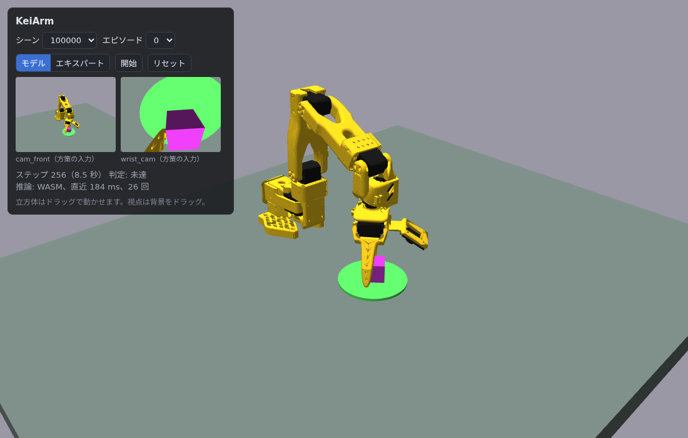
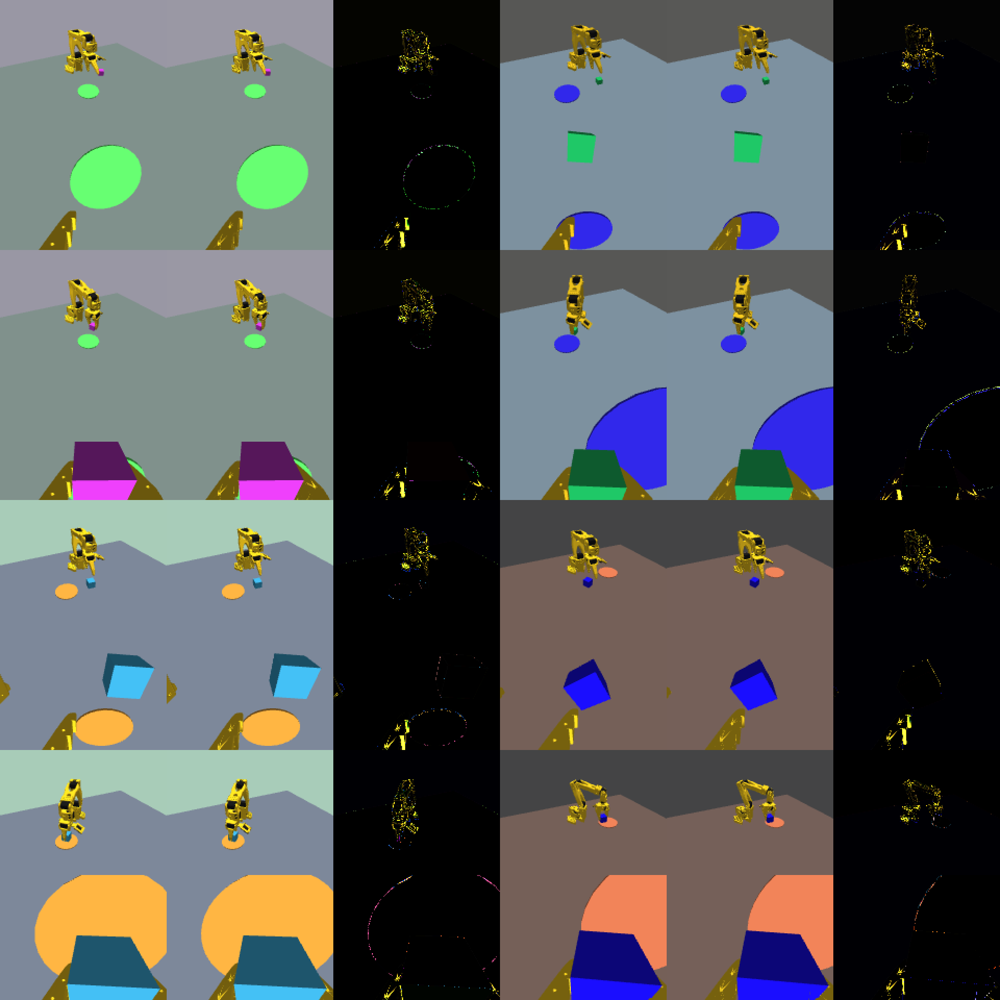
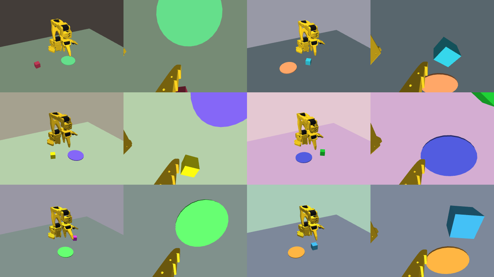

# KeiArm（仮称）

SO-101（5関節＋グリッパ）を題材にした軽量クローズドループ・マニピュレーション環境。
物理は MuJoCo を借り、シーン生成・エキスパート・学習・評価・ブラウザデモは自作する。

現在は Phase 7 の公開手前まで完了。カメラ画像と関節角だけを見る方策（893 万パラメータ）が、未見の評価シーンで 298/300、途中で立方体を別の場所へ動かす外乱つきでも 299/300。同じモデルをブラウザ内（MuJoCo WASM + three.js + onnxruntime-web）で動かしても 297/300、外乱つき 300/300。

```bash
./setup.sh
MUJOCO_GL=egl uv run python scripts/demo.py   # runs/phase0_demo.mp4
uv run python scripts/eval.py --policy expert  # 評価レポート（runs/eval_summaries/）
uv run pytest -q
```

## ブラウザ

```bash
uv run python scripts/export_web.py   # シーンとメッシュを web/public/ へ
npm --prefix web install
npm --prefix web run dev              # http://localhost:5173（WebGL2 が必要）
```

物理（MuJoCo WASM）、描画（three.js）、推論（onnxruntime-web）のすべてがブラウザ内で動く。モデルの書き出しは `uv run python scripts/export_onnx.py --run r1`。立方体はドラッグで動かせて、方策は掴み直す。



方策が見るカメラ画像は、Python（`mujoco.Renderer`）とブラウザ（three.js）でほぼ同じになるよう合わせてある（平均絶対差 0.6/255）。



左から MuJoCo、three.js、差の 4 倍。

## 速度

`uv run python scripts/bench.py`。MuJoCo 3.17.0、Intel Core i5-10400F、GeForce RTX 3060（EGL）、単一プロセス。

| 測定 | 実時間比 | 制御ステップ/秒 |
|---|---|---|
| 物理のみ（30 Hz 制御、8 サブステップ） | 155x | 4635 |
| 物理 + カメラ 2 台（160x120） | 48x | 1428 |

| 測定 | 時間 |
|---|---|
| シーン生成（サンプリング + モデルのコンパイル） | 52 ms |
| 同上 + レンダラ生成 | 205 ms |



## 出典とライセンス

- 本体: MIT（[LICENSE](LICENSE)）
- `third_party/robotstudio_so101/`: [MuJoCo Menagerie](https://github.com/google-deepmind/mujoco_menagerie) 由来、Apache-2.0。
  取得コミットは [VENDORED.md](third_party/robotstudio_so101/VENDORED.md)。
