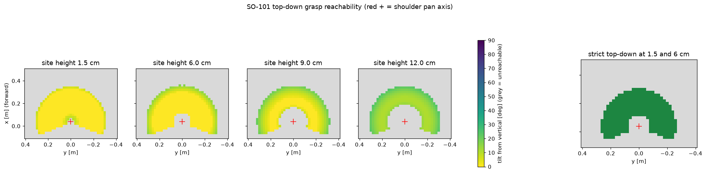

# SO-101 モデル調査メモ

調査日: 2026-11-10 / MuJoCo 3.17.0 / Menagerie コミット `98a70c5`（2026-11-02）
再現: `uv run python tools/inspect_so101.py`

## 概要

- ファイル: `third_party/robotstudio_so101/so101.xml`（本体のみ。床・照明なし）。`scene.xml` は床つき、`scene_box.xml` は箱と把持キーフレームつき
- README 上の要件は MuJoCo 3.1.3 以降
- nq = nv = nu = 6、ボディ 9、ジオム 50、メッシュ 18、総質量 0.645 kg
- メッシュは STL 19 個で計 18 MB（最大 2.7 MB）。ブラウザ配信時は間引きを検討する

## 関節とアクチュエータ

関節順 = アクチュエータ順 = 下表の順。関節名とアクチュエータ名は同一。

| # | 名前 | 可動範囲 [rad] | [deg] | ctrl 範囲 [rad] |
|---|---|---|---|---|
| 0 | shoulder_pan | ±1.9199 | ±110 | ±1.9199 |
| 1 | shoulder_lift | ±1.7453 | ±100 | ±1.7453 |
| 2 | elbow_flex | ±1.69 | ±96.8 | ±1.69 |
| 3 | wrist_flex | ±1.6581 | ±95 | ±1.6581 |
| 4 | wrist_roll | −2.7438 … +2.8412 | −157.2 … +162.8 | 同じ |
| 5 | gripper | −0.1745 … +1.7453 | −10 … +100 | 同じ |

- 全て位置制御（`<position>`）。kp = 998.22、kv = 2.731、forcerange = ±2.94 N·m
- 関節: damping 0.6、armature 0.028、frictionloss 0.052
- XML のコメントによると、ゲインは LeRobot のサーボゲインと 1 対 1 対応ではない（サーボ P ゲイン 16 を仮定した換算値）
- バックラッシュ用の default クラスは定義だけあり、未使用

### LeRobot との照合

`lerobot/src/lerobot/robots/so_follower/so_follower.py`（main、2026-11-10 取得）のモーター定義:
`shoulder_pan(1), shoulder_lift(2), elbow_flex(3), wrist_flex(4), wrist_roll(5), gripper(6)`、全て sts3215。

- **名前と順序は Menagerie と完全に一致**。行動の順序はこのまま採用する（`keiarm/robot.py` の `JOINT_NAMES`）
- 単位は異なる。LeRobot は本体5関節が度または −100…100 の正規化、グリッパは 0…100。本プロジェクトの行動は rad。実機互換を足す時は変換層が要る
- LeRobot の観測・行動キーは `<関節名>.pos`

## シミュレーション設定

- `timestep = 0.005`（200 Hz）、integrator = implicitfast、solver = Newton、iterations = 10、ls_iterations = 20
- cone = elliptic、impratio = 10（把持向けの設定）
- 30 Hz と割り切れない（1/30 ÷ 0.005 = 6.67）。**本プロジェクトは `timestep = 1/240` × 8 サブステップに変更して使う**（`keiarm/config.py`）。元の値より細かい側に倒した。立方体の静止とアームの姿勢保持はテストで確認済み。把持で問題が出たら Phase 2 で見直す

## グリッパ

- **可動指は片側のみ**。固定指は `gripper` ボディ（wrist_roll の子）の一部、可動指は `moving_jaw_so101_v1` ボディで、`gripper` ヒンジで開閉する
- 指先間距離（指先球どうし）: −0.175 rad で 4 mm、0.1 rad で 24 mm、0.65 rad で 66 mm、全開 1.745 rad で 133 mm。開度は角度に対してほぼ線形（約 73 mm/rad）
- 片側開閉なので、閉じる途中で物体は固定指側へ押される。把持位置の決め方に影響する（Phase 2）

### 衝突形状と摩擦

- アーム各リンク: 箱プリミティブ（group 3、condim 3、摩擦 1.0）
- グリッパ: 箱・球・カプセルのプリミティブ（group 3）＋凸メッシュ3個（group 4、maxhullvert 64）。両方とも衝突が有効
- グリッパの接触設定: condim 6、friction `1 5e-3 5e-4`、solref `0.01 1`、priority 1。つまり **相手の摩擦設定に関係なくグリッパ側の値が使われる**
- 指先には半径 0.75 mm の球が各3個あり、細い接触点を作っている
- 表示用メッシュ（group 2）は衝突なし
- `base` ボディには衝突形状がない（机や物体と台座は衝突しない）
- 自己衝突の除外（`<contact><exclude>`）は定義されていない
- `scene_box.xml` に 40×40×60 mm の箱（摩擦 1、solref 0.01 1）と、それを持ち上げた状態の `pickup` キーフレームがある。この設定で把持が成立する傍証。立方体はまずこの箱の設定を踏襲し、一辺 25–40 mm から始める
- 摩擦パッド相当の追加調整が要るかは Phase 2 で実際に掴んで判断する（現時点では不要の見込み）

## カメラ・サイト・キーフレーム

- カメラ: `wrist_cam` が既にある（`camera_mount` ボディ、fovy 61°）。**設計図の `cam_wrist` はこれを使う**（名前は Menagerie に合わせて `wrist_cam`）。`cam_front` は自前で追加する
  - 手首カメラには両指が常に写り込む（`runs/phase0_demo.mp4` で確認）
- サイト: `baseframe`（台座原点）、`gripperframe`（指の間、IK の手先目標に使う）
  - 全関節 0 のとき `gripperframe` は (0.391, −0.001, 0.246) m。アームは +x 方向に伸びた姿勢
  - `gripperframe` の軸: **+x が接近方向**（指先の向き、wrist_roll の回転軸と平行）、**z が開閉方向**（固定指は −z 側 約 20 mm、可動指は +z 側へ開く）、y が指のヒンジ軸
  - サイト原点はほぼ指先の高さにあり、指の中央ではなく固定指寄り。一辺 s の立方体を掴む時、立方体の中心はサイトの z = −20 mm + s/2 付近に来る
- キーフレーム: `so101.xml` にはなし（ホーム姿勢は自前で定義する）

## IK（mink 1.4.0）

`uv run python tools/check_ik.py`。`gripperframe` の位置のみ（姿勢コスト 0）、関節制限つき、グリッパ関節は固定。

- 到達可能な 8 点全てで誤差 1 mm 未満（2–15 反復）。x = 0.60 m は到達不能で失敗（期待どおり）
- 高さ 3–5 cm では x = 0.15–0.45 m の範囲で解けた

## 下向き把持の到達範囲（設計図 5.5）

`uv run python tools/reachability.py`（約 70 秒）→ `docs/reachability.png`、`docs/reachability.json`。
2 cm 格子、サイト高さ 1.5 / 6 / 9 / 12 cm で、接近軸を真下に向ける IK を総当たり。机にめり込む姿勢は除外。

- 5 関節でも「真下向き + 任意のヨー」は取れる（位置 3 + 傾き 1 + ロール 1）。ヨーは wrist_roll で決まる
- 高さ 1.5 cm と 6 cm の両方で真下を向ける領域は、**肩の旋回軸（x = 0.039, y = 0）から半径 0.10–0.24 m の環状**。方位は ±110° 程度まで
- **高くなるほど狭くなる。** 9 cm では半径 0.15–0.22 m だけ、**12 cm では真下向きはどこでも不可能**（wrist_flex が上限 95° に当たる）。12 cm でも 10–25° 傾ければ届く
- 設計への影響: 搬送高さは 6–8 cm 程度に抑えるか、搬送中は傾きを許す。立方体（一辺 3.5 cm 以下）と皿（厚さ 4 mm）なら 6 cm で足りる
- 出現範囲（`keiarm/scene.py`）: 立方体は半径 0.13–0.22 m、皿の中心は 0.15–0.22 m、方位 ±60°
- 腕どうしの自己衝突と、掴んだ立方体の干渉は見ていない
